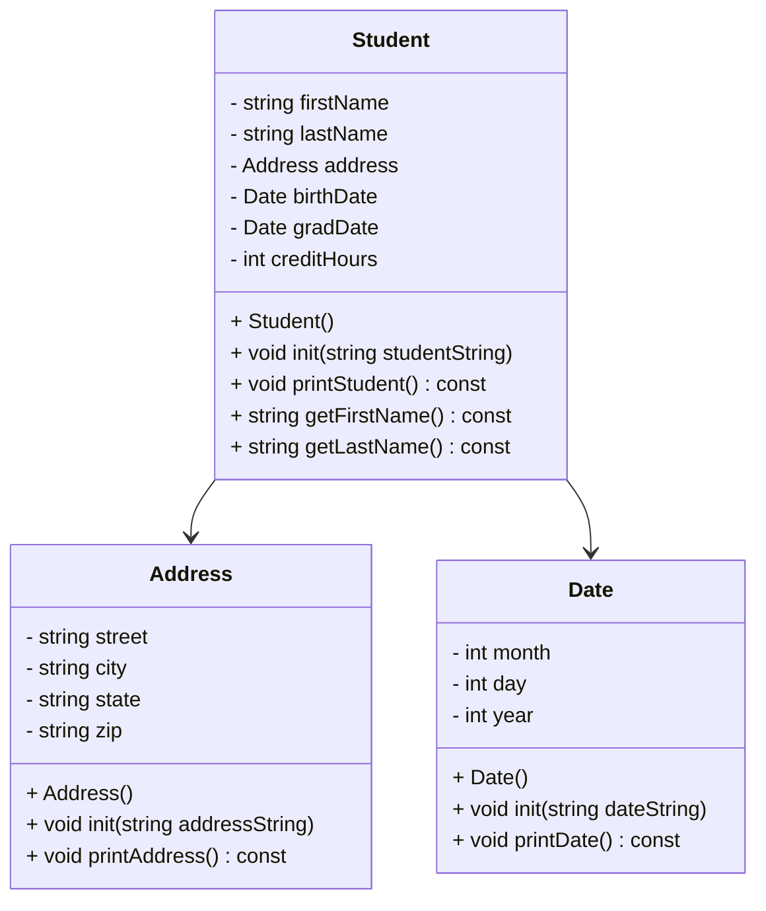

# heapStudents2
10/23/2026



Address::Address()
```
Constructor: initialize street, city, state, zip to empty strings
```

void Address::init(std::string addressString)
```
Initialize the address using a comma separated string
Expected format "street,city,state,zip"
Send addressString to a stringstream and use getline with ',' to fill each field
```

void Address::printAddress() const
```
Output street followed by an endline, then "city state, zip" followed by endline
```

Date::Date()
```
Constructor: initialize month, day, year as integers with values of 0
```

void Date::init(std::string dateString)
```
Read Date from students.csv file as strings
dateString is a string in the format "month/day/year"
Send the dateString to a stringstream and parse it into date fields using getline with '/'
Need to use temp variable to hold the value of each field before converting with stoi
```

void Date::printDate() const
```
Using an array of strings called months, convert the numeric month to actual month name
Only accept months >= 1 && <= 12, else output "Invalid date"
Uses months[month - 1] as index
Output format: "Month day, year"
```

Student::Student()
```
Constructor: establish firstName, lastName as empty strings and creditHours as 0
(address, birthDate, gradDate are set up by their own constructors)
```

void Student::init(std::string studentString)
```
Establish stringstream ss(studentString)
Using temp string to hold data while parsing

Read first and last names
Read address fields (street, city, state, zip)
Combine address fields into single comma separated string for Address::init() to parse
Read birthDate into temp and call birthDate.init(temp)
Read gradDate into temp and call gradDate.init(temp)
Read creditHours into temp and convert using stoi
```

void Student::printStudent() const
```
Output "Name: " firstName lastName
Output "Address: " then address.printAddress()
Output "Birth Date: " then birthDate.printDate()
Output "Graduation Date: " then gradDate.printDate()
Output "Credit Hours: " creditHours
Output "----------------------------------------" for style
```

std::string Student::getFirstName() const
```
Return firstName
```

std::string Student::getLastName() const
```
Return lastName
```

void loadStudents(std::vector<Student*>& students)
```
Open "students.csv" file
If the file did not open
    Output an error message and return

Delete every Student* already in the vector, then clear the vector
(to prevent memory leak/duplicate students)

while (std::getline(file, line)) {
    Create a new Student
    student->init(line) to initialize the student using the current row
    Add the student pointer to the vector
}
Close file
```
void printStudents(std::vector<Student*>* students)
```
Print all students stored in the vector
    for (i = 0; i < students.size(); i++) {
        students[i]->printStudent();
    }
Print "Total students: " students.size()
```

void findStudent(const std::vector<Student*>& students)
```
If the vector is empty
    Output "No students loaded. Choose option 1 first." and return

Ask for first name and last name, store in first and last
Set found = false

for each student in the vector
    If getFirstName() == first AND getLastName() == last
        Call printStudent()
        Set found = true

If found is false
    Output that no student with that name was found
```

void delStudents(std::vector<Student*>& students)
```
If the vector is empty
    Output "No students loaded. Choose option 1 first." and return

Prompt for first name and last name, store in first and last
Set deleted = 0, i = 0

while (i < students.size())
    If students[i] first and last name match
        delete students[i]
        remove the pointer from the vector
        deleted++
        don't delete i because that will be the next student
    Else
        i++

If deleted == 0
    Output that no student with that name was found (nothing to delete)
Else
    Output how many students were deleted and how many remain
```

int main()
```
Create a vector to store all Student* pointers
Create int choice, set to 0

while (choice != 4)
    Output the menu:
        [1] Load Student List & Show Students
        [2] Search for Student (firstName, lastName)
        [3] Delete a Student
        [4] Exit
    Read choice
    If the input is not a number
        

    If choice == 1, call loadStudents and printStudents
    Else if choice == 2, call findStudent(students)
    Else if choice == 3, call delStudents(students) [deleted students stay deleted until you exit]
    Else if choice == 4, output "Goodbye!"
    Else output "Invalid option. Please select 1, 2, 3, or 4."

Before exiting, delete every remaining Student* in the vector, and reset back to 50 students
Return 0
```
