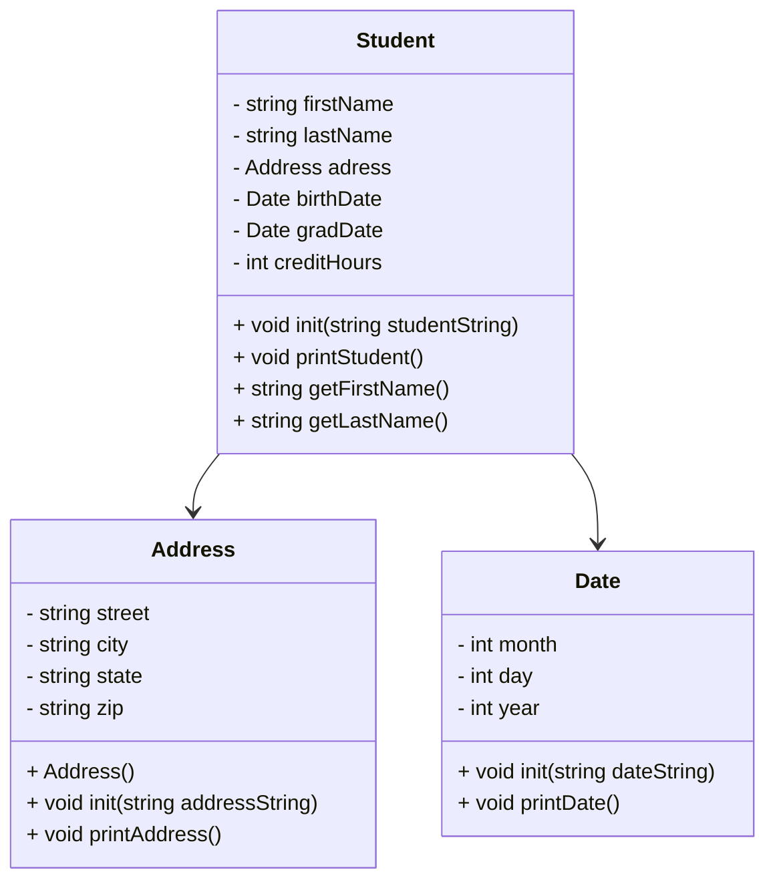

# heapStudents2
10/20/2026



Address::Address
```
Constructor: initialize street,city,state,zip to empty strings 
```

void Address::init(std::string addressString) 
```
Initialize the address using comma separated strings
Expected format "street, city, state, zip"
```

void Address::printAddress()
```
Output street followed by an endline, then city, state, zip followed by endline.
```

Date::Date()
```
Initialize month, day, year as integers with values of 0.
```

void Date::init(std::string dateString)
```
Read Date from students.csv file as strings
dateString is a string in the format "month/day/year"
Send the dateString to a stringstream and parse it into date field
Need to use temp variable to hold the value of each field before converting
```

void Date::printDate()
```
Using an array of strings called months, convert the numeric month to actual month name
Only accept months >= && <= 12, else "Invalid date"
Uses months[month - 1] as index
```

Student::Student() 
```
Establish firstName, lastName as empty strings and creditHours as 0.
```

void Student::init(std::string studentString)
```
Establish stringstream ss(studentString)
Using temp string to hold data while parsing

Read first and last names
Read address fields
Combine address fields into single string for Address::init() to parse
Read and Initialize birthDate, gradDate to temp and creditHours to temp using stoi
```

void Student::printStudent()
```
Output firstName, lastName
Birth Date: (birthDate.printDate())
Graduation Date: gradDate.printDate()
Credit Hours: creditHours
"-----------------------" for style

getFirstName(), return firstName
getLastName(), return lastName
```


int main()
```
Open "students.csv" file
Create a vector to store all Student objects

    while (std::getline(file, line)) {
        Read each line from CSV file (std::getline(file, line)
        Create Student student (makes student object)
        student.init(line) to initalize the student using the current row
        Add students to the vector
    }
Close file

// printStudents
Print all students stored in the vector
    for (int i = 0; i < students.size(); i++) {
        students[i].printStudent();
}
Print "Total Students: " students.size()

// TODO: findStudent(std::vector<Student*>&)
// TODO: delStudents(std::vector<Student*>&)
// TODO: loadStudents
// TODO: showStudentNames
```


